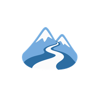

<h1 align="center">Senderos Argentina</h1>

<p align="center">
  
</p>

**Integrantes:** Federico Busum Fradera y Matías Galván

---

## Cómo levantar el proyecto en local

### Requisitos previos
* Android Studio actualizado (el proyecto usa AGP 9.4 y Gradle 9.6). El JDK lo descarga Gradle solo la primera vez.
* Un emulador o un celular con Android 8.0 o superior (`minSdk 26`). Para probar el seguimiento con GPS conviene un celular real.
* Git para clonar el repositorio.

### Pasos de ejecución
1. **Clonar el repositorio:**
   ```bash
   git clone https://github.com/fedebf03/SenderosArgentina.git
   ```
   Después abrirlo con Android Studio y esperar a que termine el Gradle Sync.

2. **Configurar Firebase:**
   Copiar el archivo `google-services.json` del proyecto de Firebase en la carpeta `app/`. El proyecto ya tiene habilitados Authentication (correo y clave, y Google) y Cloud Firestore, con las reglas de `firestore.rules` publicadas.

3. **Configurar Cloudinary (fotos):**
   Agregar al archivo `local.properties` (el que crea Android Studio) las dos líneas que están en `local.properties.example`:
   ```properties
   cloudinary.nombreNube=disbfh4at
   cloudinary.presetSubida=senderosargentina
   ```

4. **Correr la app:** elegir el módulo `app` y tocar Run.

---

## Enfoque y decisiones técnicas

**Senderos Argentina** es una app nativa de Android para senderismo. Permite crear y guardar senderos con su trazado en el mapa, seguirlos caminando con GPS, registrar caminatas libres, marcar puntos de interés con fotos y compartir senderos con otros usuarios. Está pensada para usarse en el campo, así que casi todo funciona sin conexión.

### Tecnologías utilizadas
* **Lenguaje y UI:** Kotlin, Jetpack Compose y Material 3 (con modo claro y oscuro).
* **Arquitectura:** MVVM con `StateFlow`, Clean Architecture separada en módulos de Gradle e inyección de dependencias con Hilt.
* **Navegación:** Navigation Compose con rutas tipadas (`@Serializable`).
* **Datos locales:** Room como fuente de verdad, SharedPreferences para las preferencias (modo oscuro y modo demostración) y archivos propios para el borrador del recorrido en curso y los pronósticos guardados.
* **Backend:** Firebase Authentication (correo y clave, y Google con Credential Manager) y Cloud Firestore. Las fotos se suben a Cloudinary.
* **APIs externas:** Open-Meteo con Retrofit, para el clima y para las alturas del perfil de elevación.
* **Mapas:** MapLibre con el estilo gratuito de OpenFreeMap, con descarga de mapas para usar sin señal.
* **Segundo plano:** WorkManager para la sincronización y un servicio en primer plano para el seguimiento del recorrido.
* **Hardware:** GPS, acelerómetro (pasos), brújula, barómetro y cámara.

### Elección de la arquitectura
Organizamos el código con Clean Architecture, dividido en módulos de Gradle. La regla principal es que las pantallas solo conocen el dominio y nunca usan directamente Room, Firestore ni Retrofit. Al estar en módulos separados, Gradle directamente no deja importar algo de una capa que no corresponde.

El dominio (`core:domain`) es Kotlin puro, sin nada de Android. Ahí están los modelos, los casos de uso y las interfaces de los repositorios. Las implementaciones están en `core:data`, que decide si un dato sale de Room, de Firestore o de una API. Esto nos permitió probar casi toda la lógica con tests que corren en la JVM, sin emulador.

Cada pantalla tiene su ViewModel, que expone un estado (`EstadoVisual`) con `StateFlow` y recibe los eventos de la pantalla. Las acciones de una sola vez, como navegar o mostrar un aviso, van por un canal aparte (`Efecto`).

### Estructura del proyecto
* `app/`: arranca Hilt, arma la navegación y aplica el tema.
* `features/auth/`: inicio de sesión, registro y recuperación de contraseña.
* `features/senderos/`: Explorar, Mis senderos, detalle del sendero, detalle público y formulario para crear y editar (con el editor del trazado en el mapa).
* `features/mapa/`: mapa con todos los senderos.
* `features/recorrido/`: pantalla del seguimiento mientras se camina.
* `features/perfil/`: perfil, edición del perfil, estadísticas, historial de recorridos y copia de seguridad.
* `core/domain/`: modelos, casos de uso, interfaces y cálculos (seguimiento, perfil de elevación, importación de GPX, duración estimada).
* `core/data/`: repositorios, sincronización, sensores, ubicación, notificaciones, mapas sin conexión y archivos.
* `core/database/`: base de datos Room (entidades y DAOs).
* `core/network/`: Firestore, Firebase Auth, Cloudinary y Open-Meteo.
* `core/ui/`: tema, componentes compartidos y el mapa.
* `core/testing/`: repositorios y fuentes falsas que usan los tests.

### Funcionalidades principales
* **Autenticación:** Registro e inicio de sesión con correo y clave o con Google. Recuperación de contraseña por correo, sin revelar si la cuenta existe.
* **Explorar y Mis senderos:** Explorar muestra los senderos públicos de todos los usuarios y los propios. Se pueden filtrar por dificultad, favoritos y guardados, buscar por nombre y ordenar por cercanía según la ubicación del usuario. Un sendero público de otra persona se puede guardar como copia en Mis senderos.
* **Detalle del sendero:** Datos técnicos, foto, mapa del trazado, perfil de elevación con desnivel y alturas, clima del punto de inicio, puntos de interés y recomendaciones. Desde ahí se puede compartir, exportar a GPX, CSV o JSON, publicar, marcar como favorito, eliminar y descargar el mapa para usarlo sin señal.
* **Crear y editar senderos:** Formulario con validaciones y un editor del trazado a pantalla completa, donde se agregan, mueven, insertan y borran puntos. También se puede importar un trazado desde un archivo GPX o CSV. La distancia sale del trazado y la duración estimada se calcula con la regla de Naismith (distancia y desnivel).
* **Seguimiento del recorrido:** Con GPS se muestra lo recorrido, lo que falta, el tiempo, la velocidad, los pasos, el ritmo y el rumbo con la brújula. Avisa la calidad de la señal y manda notificaciones al acercarse a un punto de interés, al desviarse del trazado y al llegar al final. Mientras se camina se pueden marcar puntos con tipo, nota y foto.
* **Caminata libre:** Se puede caminar sin un sendero cargado. Al terminar, la caminata queda en el historial y se puede convertir en un sendero nuevo con su trazado y sus puntos.
* **Perfil:** Edición de nombre, foto y ubicación, estadísticas (cantidad de recorridos, distancia, tiempo y pasos), historial de recorridos, modo oscuro y modo demostración.
* **Copia de seguridad:** Exporta todos los senderos a un archivo JSON y los vuelve a importar. Si la copia trae senderos que ya existen, pregunta si se reemplazan o se conservan los actuales.

### Modo offline y sincronización
Todo se guarda primero en Room y queda marcado como pendiente. Después, un trabajo de WorkManager lo sube a Firestore cuando hay conexión, con reintentos que se van espaciando si falla. Al bajar datos de la nube, gana la versión con la fecha de modificación más nueva.

Si una foto no se puede subir (por ejemplo, sin conexión o con Cloudinary caído), el sendero se sube igual y la foto se reintenta en la próxima sincronización.

Durante un recorrido, cada 30 segundos se guarda un borrador en un archivo local. Si Android cierra la app en medio de la caminata, al volver a abrirla se ofrece recuperar ese recorrido.

Para usar el mapa sin señal, se descarga la zona alrededor del trazado (un corredor de 1 km, con zoom de 10 a 16). Si después se edita el trazado, la app avisa que el mapa descargado quedó desactualizado.

### Seguridad
Las reglas de Firestore (`firestore.rules`) separan los datos de cada usuario: cada uno solo puede leer y escribir sus propios senderos, recorridos y perfil. Los senderos públicos los puede leer cualquier usuario con sesión iniciada, pero solo su autor los puede crear, editar o borrar. Cualquier otra ruta está bloqueada.

Las fotos se suben a Cloudinary con un preset sin firma, así la app no tiene que guardar ninguna clave secreta.

### Permisos
* **Ubicación precisa:** para el seguimiento y para ordenar los senderos por cercanía.
* **Notificaciones (Android 13 o superior):** para los avisos del recorrido y de la sincronización.
* **Servicio en primer plano:** para que el seguimiento siga con la pantalla apagada o con la app minimizada.
* La cámara se abre con el selector del sistema, por eso no hace falta pedir su permiso.
